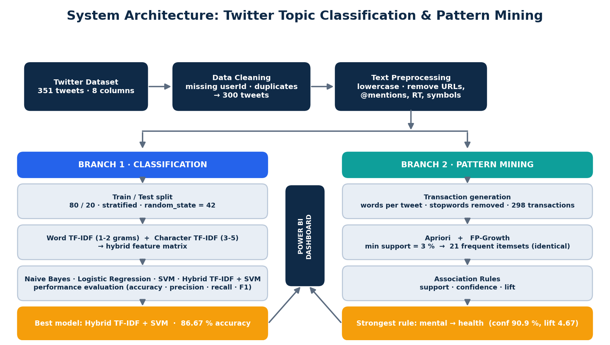
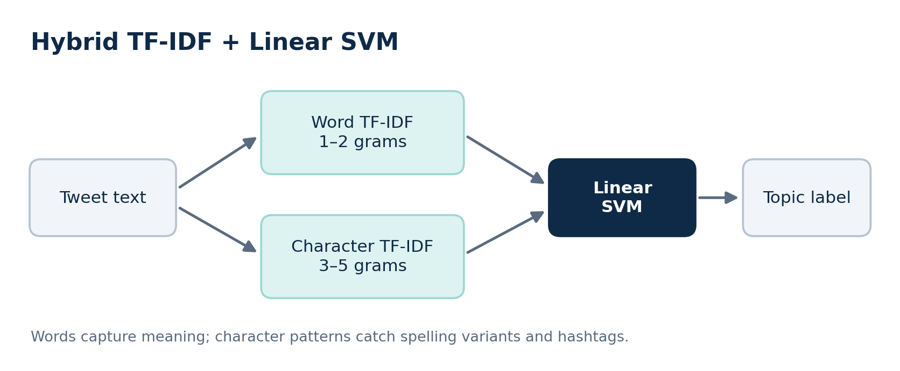
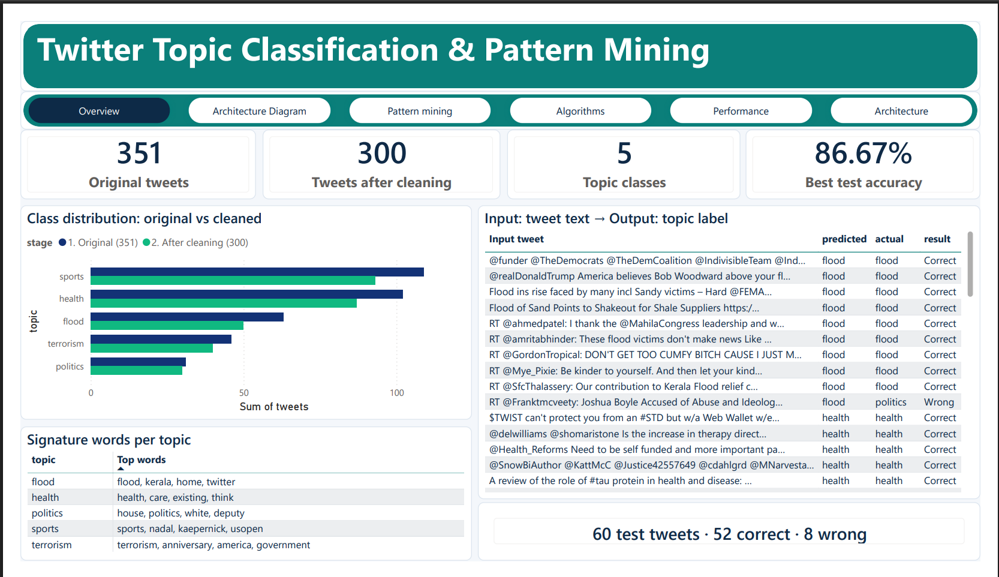
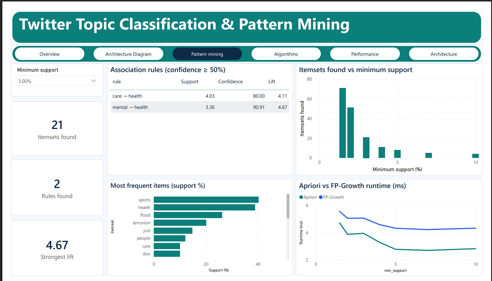
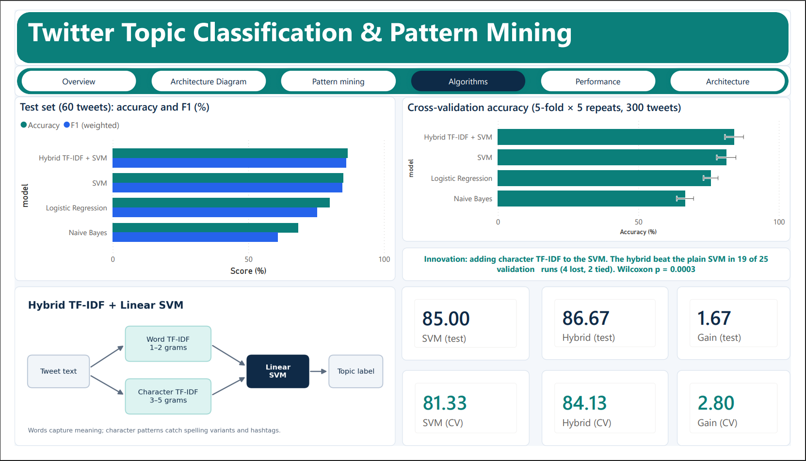
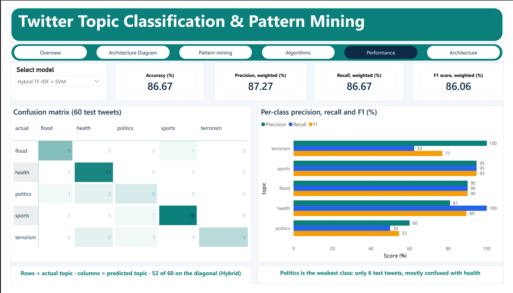

# Twitter Topic Classification & Pattern Mining

Classify tweets into five topics and mine word patterns, with all results shown in a
five-page Power BI dashboard.

- **Classification:** Naive Bayes, Logistic Regression, SVM and a Hybrid TF-IDF + SVM
- **Pattern mining:** Apriori and FP-Growth with association rules (support, confidence, lift)
- **Dashboard:** Power BI, with a model slicer and a minimum-support slicer

## Key results

| Item | Value |
|---|---|
| Original / cleaned tweets | 351 / 300 |
| Topics | sports, health, flood, terrorism, politics |
| Train / test split | 240 / 60 (80/20, stratified, `random_state=42`) |
| Best model | **Hybrid TF-IDF + SVM** |
| Best test accuracy | **86.67%** |
| Best cross-validated accuracy (5-fold x 5 repeats) | 84.13% (+/- 3.30) |
| Frequent itemsets at 3% support | 21 (Apriori = FP-Growth) |
| Strongest rule at 3% support | mental -> health (confidence 90.91%, lift 4.67) |

### Model comparison

| Model | Test accuracy | Precision | Recall | F1 | CV accuracy |
|---|---|---|---|---|---|
| Naive Bayes | 68.33 | 69.41 | 68.33 | 60.92 | 66.67 +/- 2.98 |
| Logistic Regression | 80.00 | 74.95 | 80.00 | 75.34 | 75.80 +/- 2.59 |
| SVM | 85.00 | 85.69 | 85.00 | 84.67 | 81.33 +/- 3.40 |
| **Hybrid TF-IDF + SVM** | **86.67** | **87.27** | **86.67** | **86.06** | **84.13 +/- 3.30** |

The hybrid beat the plain SVM in 19 of 25 cross-validation runs (4 lost, 2 tied),
Wilcoxon p = 0.0003.

## System architecture



## The Hybrid TF-IDF + Linear SVM model



Word TF-IDF (1-2 grams) captures meaning. Character TF-IDF (3-5 grams) catches spelling
variants and hashtags. The two feature sets are joined and fed to a linear SVM.

## Dashboard

| Page | What it shows |
|---|---|
| Overview | Dataset size, class distribution, input tweet to output topic table |
| Architecture | Rows at each pipeline stage, train/test split by topic |
| Architecture Diagram | The system architecture |
| Pattern mining | Minimum-support slicer, itemsets, association rules, Apriori vs FP-Growth runtime |
| Algorithms | Model comparison, cross-validation with error bars, hybrid innovation |
| Performance | Model slicer, accuracy/precision/recall/F1, confusion matrix, per-class metrics |






## Repository structure

```
.
├── README.md
├── LICENSE
├── requirements.txt
├── .gitignore
├── data/
│   ├── README.md              data dictionary
│   └── processed/             CSV tables used by the dashboard
├── notebooks/                 Jupyter notebook with the full pipeline
├── dashboard/                 Power BI file (.pbix) and exported PDF
└── docs/
    ├── architecture_diagram.png
    ├── hybrid_flow_diagram.png
    ├── POWER_BI_BUILD_GUIDE.md
    ├── design/                dashboard design mockup
    ├── screenshots/           final dashboard screenshots
    └── report/                project report
```

## How to run

1. Clone the repository and install the requirements:
   ```bash
   git clone https://github.com/<your-username>/twitter-topic-classification-pattern-mining.git
   cd twitter-topic-classification-pattern-mining
   pip install -r requirements.txt
   ```
2. Open the notebook in `notebooks/` and run all cells to regenerate the CSV tables.
3. Open `dashboard/twitter_dashboard.pbix` in Power BI Desktop. If the data sources show an
   error, point them to `data/processed/` (Home > Transform data > Data source settings).
4. Use the **Minimum support** slicer on the Pattern mining page and the **model** slicer on
   the Performance page to explore the results.

## Limitations

- Small dataset (300 tweets) and imbalanced classes; politics has only 30 tweets and is the weakest class.
- The test set has only 60 tweets, so single-split results are noisy. Cross-validation is the stronger evidence.
- Apriori and FP-Growth return identical results and run in milliseconds at this size, so their runtimes cannot be compared meaningfully.

## Team

- [Inderjot Singh Matharoo]
- [Vaibhav Mali]

## License

MIT License. See [LICENSE](LICENSE).
